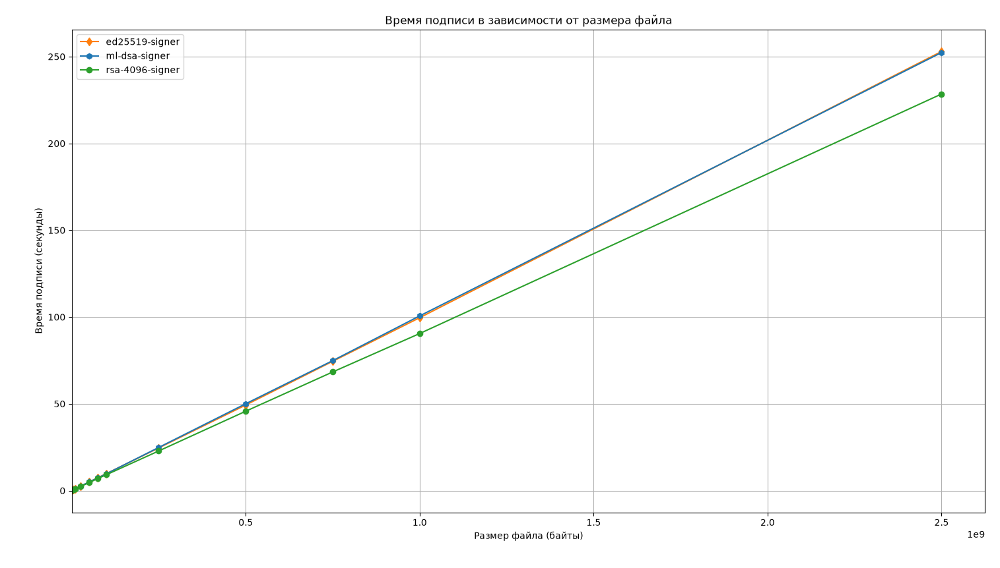
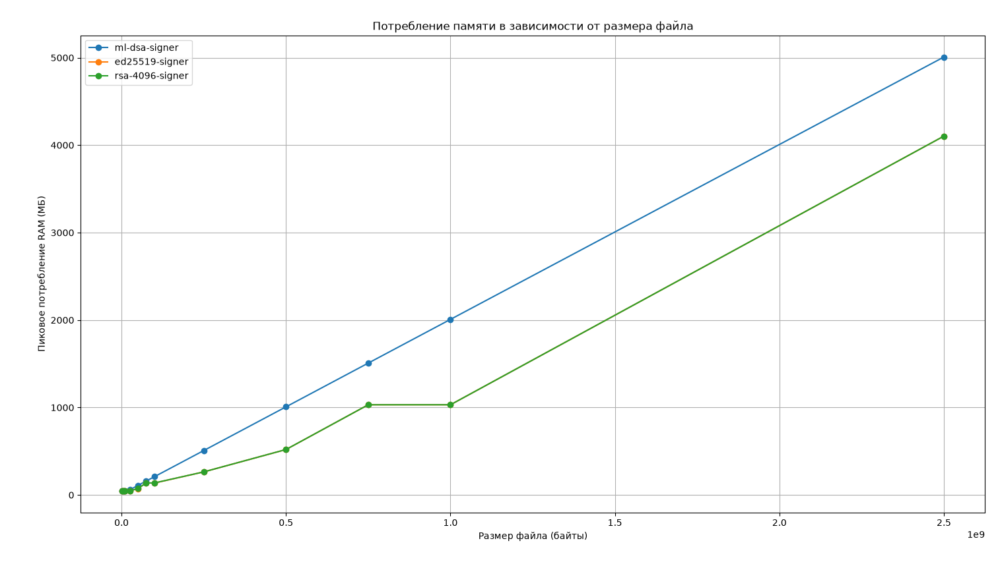

# LinuxPostQuantumUpdateSigner

Курсовая работа за 9-й семестр

## Цель работы

Исследовать возможности интеграции постквантового алгоритма цифровой подписи на решётках в механизм проверки целостности и подлинности обновлений ОС Linux и разработать прототип решения, учитывающего угрозу применения квантового компьютера.

## Задачи

1. Изучить теоретические основы постквантовой криптографии, в частности алгоритм цифровой подписи ML-DSA, основанный на CRYSTALS-Dilithium.
2. Проанализировать механизмы проверки целостности и подлинности пакетов и метаданных репозиториев в Linux, а также связанные механизмы доверенной загрузки, включая Secure Boot и проверку подписи ядра.
3. Исследовать возможности использования ML-DSA в OpenSSL и других криптографических библиотеках Linux.
4. Разработать прототип подсистемы проверки постквантовых подписей при обновлении компонентов ОС.
5. Провести экспериментальную оценку решения: измерить время создания и проверки подписей, их размер и накладные расходы.
6. Проанализировать ограничения практического применения постквантовой криптографии в Linux и сформулировать рекомендации по миграции.

## План выполнения работы

1. Реализовать модуль создания цифровой подписи ML-DSA.
2. Реализовать модуль проверки цифровой подписи.
3. Реализовать для Arch Linux обёртку над pacman, которая проверяет постквантовую подпись пакетов из тестового репозитория перед установкой.
4. Сравнить эффективность постквантового и классических алгоритмов подписи.

# Выполнение

## Подготовка тестового стенда

### Настройка виртуальных машин и клиента

В VirtualBox созданы две виртуальные машины с Arch Linux. Первая используется как сервер тестового репозитория, вторая — как клиент.


На каждой виртуальной машине настроен сетевой интерфейс `enp0s8` со статическим адресом:

- сервер: `10.10.10.20`;
- клиент: `10.10.10.10`.


На клиенте в `/etc/pacman.conf` добавлена секция:

```ini
[TestRepo]
SigLevel = Optional TrustAll
Server = http://10.10.10.20:8000
```

Репозиторий `TestRepo` доступен по HTTP на порту 8000 серверной машины. На этапе настройки стенда `Optional` разрешает отсутствие подписи, а `TrustAll` ослабляет требования к уровню доверия ключу в связке. При наличии подпись всё равно проверяется. Поэтому успешная установка тестового пакета при этой конфигурации не подтверждает проверку цифровой подписи.

### Создание тестового пакета

Для проверки репозитория создан Python-скрипт `test`:

```python
#!/usr/sbin/python3
print('hello from test repo!')
```

На серверной машине используется структура:

```text
~/workspace/
├── build/     # исходные файлы и результаты сборки
├── keys/      # ключи для экспериментов
└── repo/      # файлы, доступные клиенту по HTTP
```

В каталоге сборки рядом со скриптом создан `PKGBUILD`:

```bash
pkgname=test-package
pkgver=1.0
pkgrel=1
pkgdesc="Test Python script for my repository"
arch=('any')
license=('custom')

depends=('python')
source=('test')

package() {
    install -Dm755 "$srcdir/test" "$pkgdir/usr/bin/test_package"
}
```

`PKGBUILD` описывает сборку пакета, включая зависимость от `python`. Функция `package()` помещает скрипт в пакет по пути `/usr/bin/test_package`; после установки этот путь создаётся на клиенте.

Для добавления контрольной суммы исходного файла и сборки выполнено:

```bash
makepkg -g >> PKGBUILD
makepkg
```

Результат сборки — архив `test-package-1.0-1-any.pkg.tar.zst`. Он скопирован в `~/workspace/repo`, где командой ниже создана база репозитория:

```bash
repo-add TestRepo.db.tar.gz test-package-1.0-1-any.pkg.tar.zst
```

Команда выполняется из `~/workspace/repo`. В результате в каталоге находятся пакет, база `TestRepo.db.tar.gz`, база списков файлов `TestRepo.files.tar.gz` и соответствующие символические ссылки `TestRepo.db` и `TestRepo.files`.

В том же каталоге запущен HTTP-сервер:

```bash
python -m http.server
```

Сервер раздаёт содержимое текущего каталога через порт 8000, пока запущен процесс.

### Проверка установки пакета

На клиентской машине пакет установлен из `TestRepo` и запущен:

```text
$ sudo pacman -S test-package
resolving dependencies...
looking for conflicting packages...

Packages (1) test-package-1.0-1

Total Installed Size:  0.00 MiB

:: Proceed with installation? [Y/n]
:: Retrieving packages...
 test-package-1.0-1-any              5.5 KiB  1385 KiB/s 00:00 [----------------------------------] 100%
(1/1) checking keys in keyring                                 [----------------------------------] 100%
(1/1) checking package integrity                               [----------------------------------] 100%
(1/1) loading package files                                    [----------------------------------] 100%
(1/1) checking for file conflicts                              [----------------------------------] 100%
(1/1) checking available disk space                            [----------------------------------] 100%
:: Processing package changes...
(1/1) installing test-package                                  [----------------------------------] 100%
:: Running post-transaction hooks...
(1/1) Arming ConditionNeedsUpdate...

$ test_package
hello from test repo!
```

В этой транзакции pacman скачал пакет из `TestRepo` и установил его. Команда `test_package` подтвердила, что установленный скрипт запускается.

## Создание программ подписи

На C++ с использованием OpenSSL реализованы программы для трёх алгоритмов:

- `ml-dsa-signer.cpp` — ML-DSA-65;
- `rsa-4096-signer.cpp` — RSA-4096-PSS с SHA-256, MGF1-SHA-256 и длиной соли, равной размеру хеша;
- `ed25519-signer.cpp` — Ed25519.

Программы получают путь к файлу и закрытому ключу PEM, считывают файл, создают подпись через OpenSSL EVP API и сохраняют её в отдельный бинарный файл. Поддержка ML-DSA-65 в используемом OpenSSL предварительно проверена командами:

```bash
openssl version
openssl list -signature-algorithms | grep ML-DSA
```

Для сборки программ:

```bash
g++ -std=c++17 -Wall -Wextra -Wpedantic ml-dsa-signer.cpp -o ml-dsa-signer -lcrypto
g++ -std=c++17 -Wall -Wextra -Wpedantic rsa-4096-signer.cpp -o rsa-4096-signer -lcrypto
g++ -std=c++17 -Wall -Wextra -Wpedantic ed25519-signer.cpp -o ed25519-signer -lcrypto
```

Для каждого алгоритма созданы отдельные закрытый и открытый ключи. Закрытые ключи используются для подписи, а открытые — для проверки; закрытые ключи не предназначены для публикации в репозитории пакетов.

### Результаты подписания файла

В приведённых журналах программы дважды подписали файл `README.md`. Первый результат:

```text
$ ./ml-dsa-signer README.md keys/mldsa-private.pem
Ключ загружен за 3564 μс
Подпись создана за 9802 μс
Пакет: "README.md"
Алгоритм: ML-DSA-65
Подпись: "README.md.mldsa"
Размер подписи: 3309 байт

$ ./rsa-4096-signer README.md keys/rsa4096-private.pem
Ключ загружен за 2876 μс
Подпись создана за 16303 μс
Пакет: "README.md"
Алгоритм: RSA-4096
Подпись: "README.md.rsa4096"
Размер подписи: 512 байт

$ ./ed25519-signer README.md keys/ed25519-private.pem
Ключ загружен за 3603 μс
Подпись создана за 2290 μс
Пакет: "README.md"
Алгоритм: ed25519
Подпись: "README.md.ed25519"
Размер подписи: 64 байт
```

Во втором запуске зафиксированы следующие значения:

| Алгоритм | Загрузка ключа, мкс | Чтение файла и создание подписи, мкс | Подпись, байт |
|---|---:|---:|---:|
| ML-DSA-65 | 3192 | 3108 | 3309 |
| RSA-4096-PSS | 2504 | 15128 | 512 |
| Ed25519 | 2634 | 1950 | 64 |

Интервал «Подпись создана» охватывает чтение файла и вычисление подписи. Запись подписи выполняется после замера. Два запуска показывают, как менялись показания встроенного таймера на одном файле.

Подписывался файл `README.md` как тестовые данные, а не пакет Arch. Поскольку подпись относится к конкретным байтам файла, после редактирования `README.md` его старые подписи не будут соответствовать новой версии.

## Создание и проверка модуля верификации

Программа `verifier.cpp` принимает название алгоритма, проверяемый файл, файл подписи и открытый ключ. Для проверки используются OpenSSL EVP API и параметры, соответствующие программам подписи. Успех возвращается только при действительной подписи; при её несоответствии или ошибке возвращается ненулевой код завершения.

Сборка:

```bash
g++ -std=c++17 -Wall -Wextra -Wpedantic verifier.cpp -o verifier -lcrypto
```

Пример проверки трёх подписей файла `README.md`:

```bash
./verifier ml-dsa-65 README.md README.md.mldsa keys/mldsa-public.pem
./verifier rsa4096-pss README.md README.md.rsa4096 keys/rsa4096-public.pem
./verifier ed25519 README.md README.md.ed25519 keys/ed25519-public.pem
```

Эти команды подходят, если файлы подписей были созданы для текущего содержимого `README.md` и соответствующими закрытыми ключами. После изменения файла их нужно создать заново.

### Результаты проверки

Программы подписи и `verifier.cpp` дополнительно собраны и проверены в отдельном временном каталоге с OpenSSL 3.6.5. Для проверки использовалась копия отчёта `sample.md` и отдельные временные пары ключей. Успешные проверки дали следующий вывод:

```text
Подпись действительна (ml-dsa-65)
Подпись действительна (rsa4096-pss)
Подпись действительна (ed25519)
```

Для отрицательной проверки к копии файла добавлены данные, после чего все три исходные подписи проверены относительно изменённого файла. В каждом случае программа вывела:

```text
Подпись НЕДЕЙСТВИТЕЛЬНА
```

Код завершения каждой такой проверки — `1`. Полученные результаты показывают работоспособность создания и проверки подписей на тестовом файле; они не подтверждают автоматическую проверку при установке пакетов через pacman.

## Экспериментальная оценка

### Методика

Для создания и проверки подписей использовались утилиты на OpenSSL для ML-DSA-65, Ed25519 и RSA-4096-PSS. Использовались 12 тестовых файлов размером 1, 5, 10, 25, 50, 75, 100, 250, 500, 750, 1000 и 2500 МиБ. Замеры проводились на локальных файлах. Установка пакета через pacman требует отдельного эксперимента.

- **Время выполнения.** Скрипты измеряют прошедшее время от вызова `subprocess.run()` до его возврата. При подписании это время включает запуск программы, загрузку ключа, чтение файла, вычисление и запись подписи. Для `verifier` тем же способом измеряется полная длительность запуска. [Скрипт подписи](Tests/sign_test.py) · [Скрипт проверки](Tests/verify_test.py)
- **Пиковое потребление памяти.** Скрипты получают максимальный размер резидентной памяти дочернего процесса (RSS) через `os.wait4()` и переводят значение из КиБ в МиБ. Пик может учитывать память, унаследованную дочерним процессом от Python при `fork()`, поэтому на малых файлах показания особенно чувствительны к способу запуска. [Замер памяти при подписи](Tests/mem_test.py) · [Замер памяти при проверке](Tests/mem_test_verify.py)

В текущих сценариях каждая точка строится по одному запуску для заданного размера файла и алгоритма. На приложенных графиках координаты оси X вычислены из имён файлов в десятичных единицах. Например, точка `2.5G` расположена на отметке 2,5 × 10⁹ байт, хотя сам файл занимает 2 621 440 000 байт (2500 МиБ). Ниже размеры файлов приведены по их фактическому объёму.

### Время создания подписи



*Рисунок 1. Время выполнения программы подписи, линейная шкала по оси X.*

На графике время растёт примерно пропорционально размеру входного файла. Для файла объёмом 2500 МиБ полное время составило около 250 с у ML-DSA-65 и Ed25519 и около 230 с у RSA-4096-PSS. Значения считаны с графика и округлены. Скрипт замера времени сохраняет длительность независимо от кода завершения подписанта, поэтому эти числа следует считать предварительными. Для сравнения скорости самих криптографических операций нужно отдельно измерить чтение файла и вызовы OpenSSL.

### Пиковое потребление памяти при создании подписи



*Рисунок 2. Пиковая резидентная память при создании подписи, линейная шкала по оси X.*

При переходе к большим файлам пиковый RSS растёт у всех трёх программ. Для файла объёмом 2500 МиБ верхняя точка ML-DSA-65 находится около 5000 МиБ. Кривые Ed25519 и RSA-4096-PSS визуально накладываются, у крайней точки значение составляет около 4100 МиБ. Подпись оси «МБ» соответствует значениям в МиБ. Все три утилиты читают файл целиком в `std::vector` перед вызовом OpenSSL. Полученный расход памяти характеризует эти реализации целиком, включая буферы чтения файла.

### Размер отделённой подписи

Для каждого из 12 размеров файлов длина бинарной подписи соответствующего алгоритма оставалась одинаковой.

| Алгоритм | Расширение | Размер подписи, байт |
|---|---|---:|
| ML-DSA-65 | `.mldsa` | 3309 |
| Ed25519 | `.ed25519` | 64 |
| RSA-4096-PSS | `.rsa4096` | 512 |

Для файла объёмом 1 МиБ размер `.mldsa` составляет около 0,32 % от размера файла. Эта величина показывает объём дополнительных данных на одну подпись при публикации и скачивании пакета.

### Время и память при проверке подписи

Текущая серия замеров требует повторного запуска после исправления сценариев проверки.

- `verify_test.py` передаёт пути к закрытым ключам. `verifier` ожидает открытый ключ в формате PEM. Кроме того, пути к ключам ML-DSA-65 и Ed25519 указаны в обратном порядке. Скрипт замеряет и запуски с ненулевым кодом завершения. Поскольку `verifier` читает файл и подпись до загрузки ключа, на такой график может попасть время чтения файла перед ошибкой.
- В `mem_test_verify.py` используется необъявленный словарь расширений `exts`. Вызову `os.execv()` также нужно передать аргументы программы одним списком. На приложенных графиках памяти при проверке в легенде указаны программы подписи, поэтому принадлежность этих кривых измерениям `verifier` требует подтверждения.

Успешные и отрицательные проверки из раздела выше подтверждают работу `verifier` на тестовом файле. Для измерения производительности следует записывать отдельные прогоны с соответствующим открытым ключом и включать в итоговую выборку успешной проверки только запуски с кодом `0`.

## Текущее состояние и следующие этапы

Подготовлен тестовый репозиторий Arch Linux, проверена установка пакета и реализованы утилиты подписи и верификации для трёх алгоритмов. Предварительные замеры показывают, как размер входного файла влияет на время и память при подписании. Следующий прикладной этап — испытать обёртку над pacman на транзакциях с пакетами из `TestRepo`.

1. Разместить подпись ML-DSA-65 рядом с архивом пакета и передать открытый ключ клиенту по доверенному каналу. Проверить установку через обёртку с действительной подписью и отказ при изменённом пакете, неверной или отсутствующей подписи. Повторить сценарии для пакета из кэша.
2. В сценариях замеров проверять коды завершения, использовать фактические размеры файлов и сохранять результаты каждого запуска. Для повторных серий зафиксировать конфигурацию стенда, версии OpenSSL и компилятора, параметры сборки и состояние файлового кэша. Для каждого сочетания размера и алгоритма привести медиану и межквартильный размах.
3. Сравнить на одном пакете штатную установку с OpenPGP-подписью и установку через обёртку с ML-DSA-65. Отдельно измерить время загрузки, верификации и установки. Оценить ограничения схемы, в том числе доверие к метаданным репозитория, управление ключами и возможность отката к старой подписанной версии.
